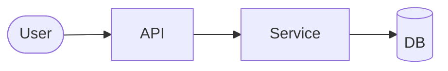

# Architecture
<!-- Keep it a MAP, not an encyclopedia (≤ 150 lines). Link to code paths. Filled by kit-onboard. -->

## Overview
TODO — 3–5 sentences + diagram.

## Modules / components
| Module | Path | Responsibility | Depends on | Must NOT depend on |
|---|---|---|---|---|
| TODO | | | | |

## Data
- Stores: TODO · Migrations: TODO (tool, folder, naming)
- Sensitive data & where it lives: TODO

## External integrations
| System | Purpose | Auth | Failure mode |
|---|---|---|---|

## Cross-cutting
- AuthN/AuthZ: TODO · Errors: TODO · Logging/observability: TODO · Config: env vars listed in `.env.example`

## Architectural rules (enforce with tests where possible, e.g. ArchUnit / dependency-cruiser / import-linter)
- TODO
