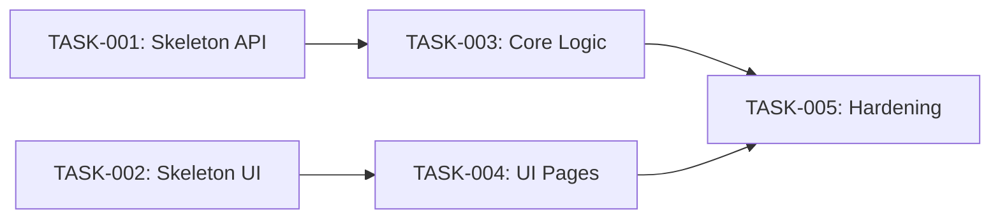

# Roadmap & plan
<!-- kit-plan điền. Task chi tiết nằm ở .agent/tasks/. -->
<!-- 
Quy tắc phân chia (3-in-1 Velocity):
- Milestone M1: Walking Skeleton (lát cắt mỏng xuyên suốt mọi tầng, chạy được ngay).
- Task breakdown: Chia theo Vertical Slice (Size M: 150-350 lines). Không chia vụn theo tầng kỹ thuật.
- Parallel: Đánh dấu các Task độc lập (Depends on = -) để chạy song song bằng worktree (kit-task start --worktree).
-->

## Milestones
| # | Milestone | Mục tiêu | Tiêu chí hoàn thành | Hạn |
|---|---|---|---|---|
| M1 | Walking Skeleton | Kết nối xuyên suốt các tầng kiến trúc | Endpoint chạy được + e2e test pass | |
| M2 | Core Features | Các tính năng chính (Must stories) | Mọi AC hoàn tất | |
| M3 | Hardening & Release | Bảo mật, tối ưu, observability, CI/CD | Pentest/DAST, load test đạt SLO | |

## Task breakdown
| Task | Milestone | Story | Depends on | Size (S/M/L) | Parallel? | Status |
|---|---|---|---|---|---|---|
| TASK-001 | M1 | US-01 | - | M | Yes | todo |

## Dependency graph

## Risks & mitigations
| Risk | Impact | Likelihood | Mitigation |
|---|---|---|---|
