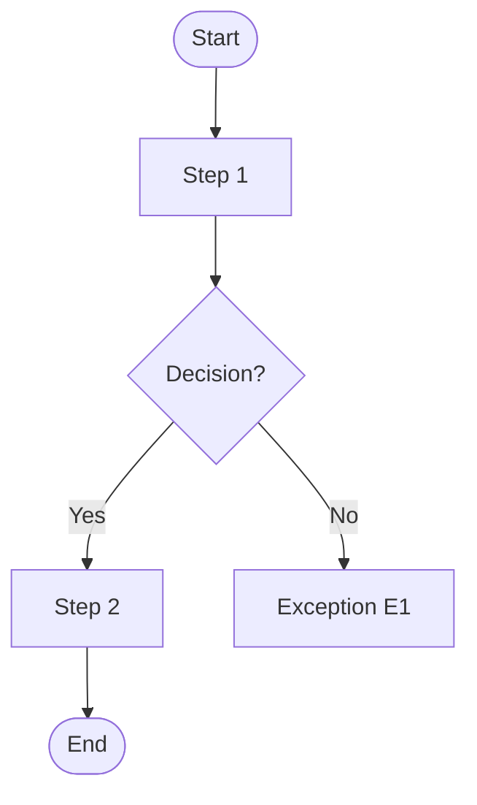
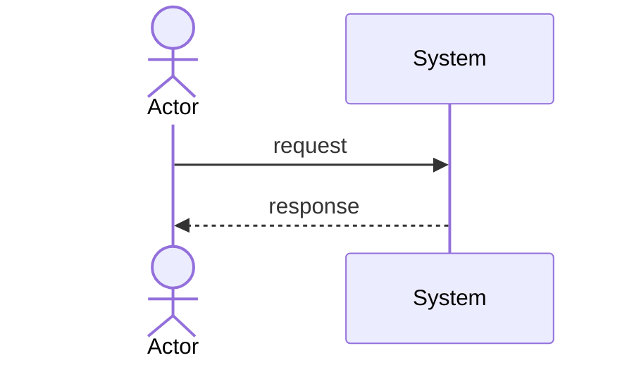

# UC-{{NUM}} {{TITLE}}

| Field | Content |
|---|---|
| Goal | |
| Primary actor | |
| Secondary actors / systems | |
| Trigger | |
| Pre-conditions | |
| Post-conditions (success) | |
| Post-conditions (failure) | |
| Business rules | BR-.. |
| Frequency / volume | |

## Main flow
1.

## Alternative flows
- A1 (at step n):

## Exception flows
- E1 (at step n):

## Activity diagram

## Sequence (system interaction)

## Open questions
