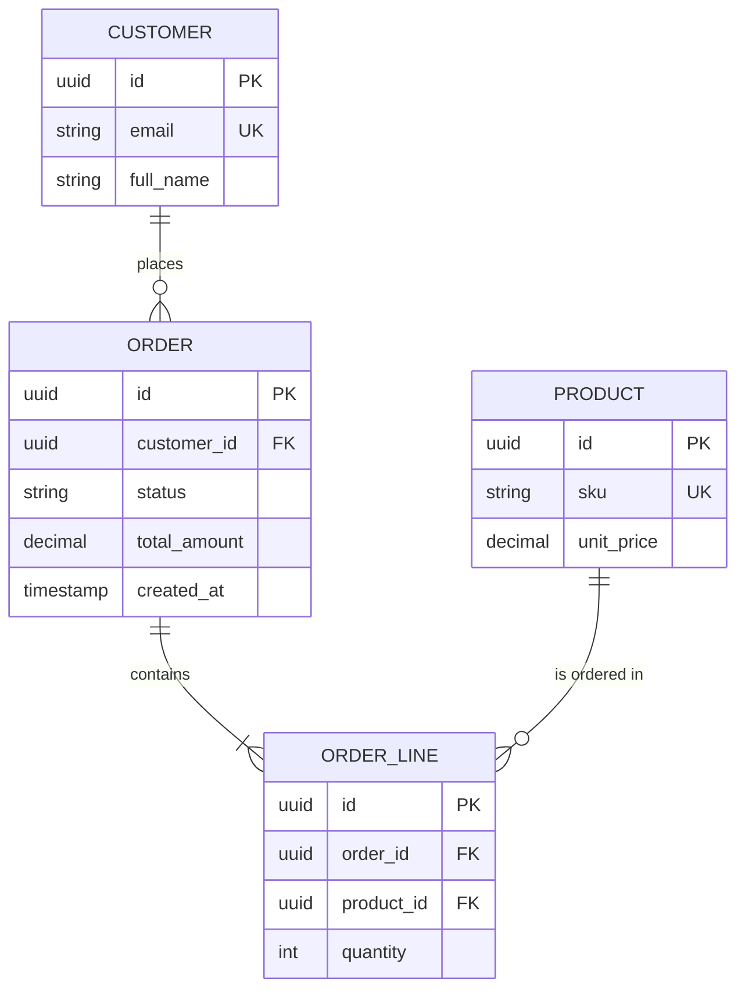

# Data model: <area>

## Data dictionary
| Entity.field | Type | Required | Validation / format | Source | PII? | Example |
|---|---|---|---|---|---|---|
| Customer.email | string(254) | yes | RFC 5322, unique, lower-case | user input | yes | a@b.vn |
