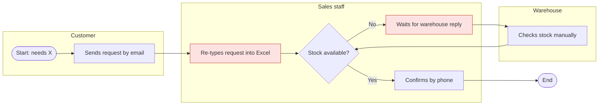
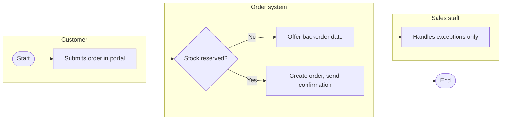

# Process: <name>
<!-- Example ids (UC-01, US-04, BR-01, FR-01 …) are illustrations: replace them with real ones after copying. kit-trace fails on
     every id that is referenced but not defined, so a copied example blocks `kit-run check` until it is adapted. -->

## As-is

Pain points: <!-- e.g. P1 re-typing (s1) ~10 min/request, P2 waiting for warehouse (s4) up to 1 day -->

## To-be


## Steps (to-be)
| # | Actor | Step | Input | Output | Rule / exception |
|---|---|---|---|---|---|
| 1 | Customer | Submit order | cart | order draft | BR-01 min order value |

<!-- PlantUML alternative when lanes must be strict:
```plantuml
|Customer|
start
:Submit order;
|Order system|
if (Stock reserved?) then (yes)
  :Create order;
else (no)
  :Offer backorder;
endif
stop
```
-->
