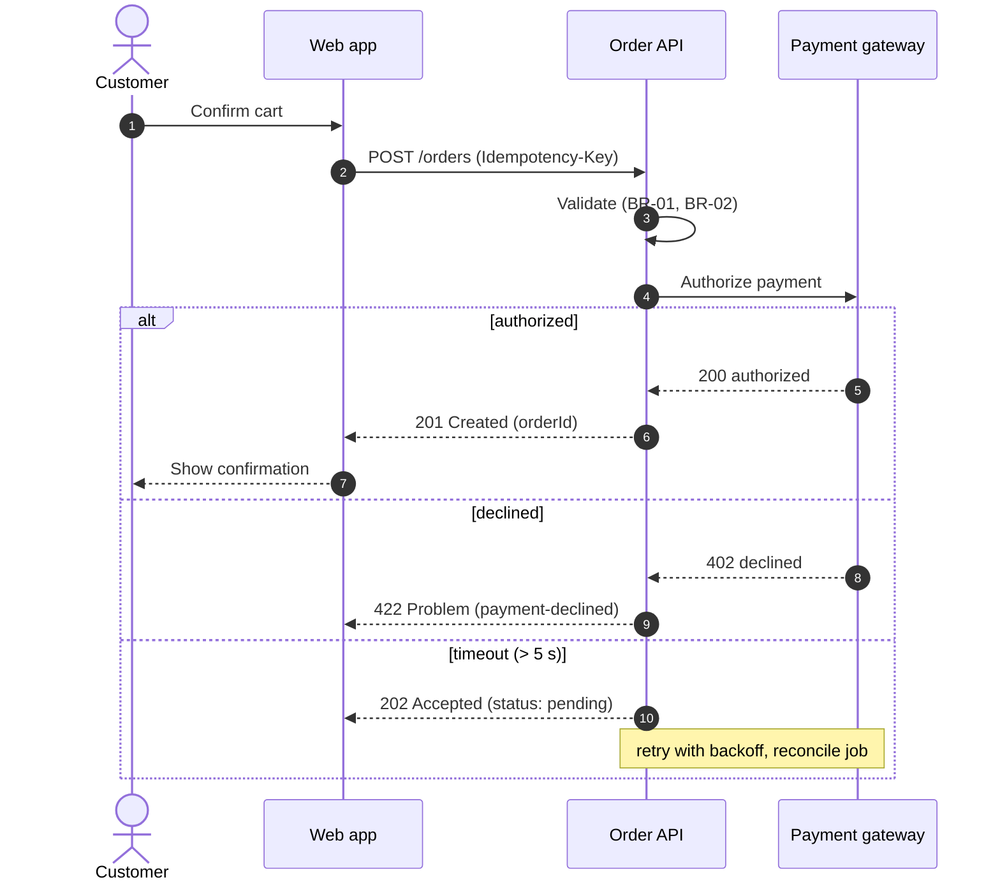

# Sequence: <interaction>
<!-- Example ids (UC-01, US-04, BR-01, FR-01 …) are illustrations: replace them with real ones after copying. kit-trace skips ids
     inside fenced blocks (this whole Mermaid diagram), so it will NOT catch a leftover example id here — check them by hand. -->

