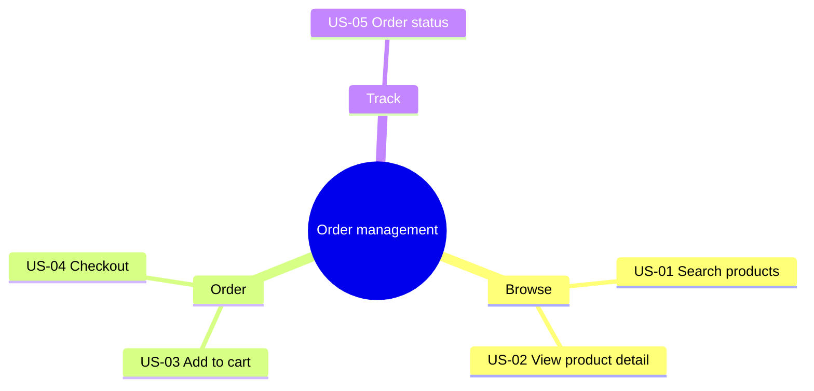

# Story map: <product / epic>
<!-- Example ids (UC-01, US-04, BR-01, FR-01 …) are illustrations: replace them with real ones after copying. kit-trace fails on
     every id that is referenced but not defined, so a copied example blocks `kit-run check` until it is adapted. -->

| Activity → | Browse | Order | Track |
|---|---|---|---|
| **Release 1 (MVP)** | US-01 | US-03, US-04 | |
| **Release 2** | US-02 | | US-05 |

### US-04 — Checkout
**As a** customer **I want** to pay for my cart **so that** my order is confirmed.
Business rules: BR-01, BR-02 · NFR: NFR-01 (p95 < 800 ms)
**Acceptance criteria**
- AC1 Given a valid cart and authorized payment, When I confirm, Then an order is created and I see its number.
- AC2 Given the payment is declined, When I confirm, Then no order is created and I see the reason.
- AC3 Given the gateway times out, When I confirm, Then the order is "pending" and I am told I will be notified.
