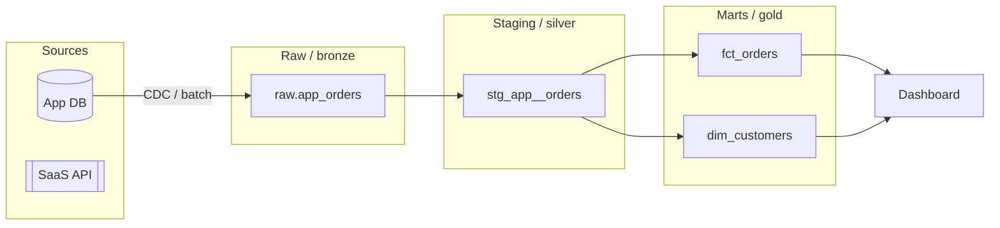

# Data architecture
<!-- Owned by the data engineer (kit-data). Living document. Decisions → docs/adr/. -->

## 1. Consumers & questions
| Consumer (dashboard / model / report / team) | Questions answered | Freshness needed | Owner |
|---|---|---|---|

## 2. Sources
See `SOURCES.md`.

## 3. Architecture
<!-- batch vs streaming, warehouse vs lakehouse, ingestion tool, orchestration — each an ADR. -->

## 4. Marts
| Mart | Grain | Keys | Incremental? | Contract | Consumers |
|---|---|---|---|---|---|

## 5. Orchestration & SLAs
| Pipeline / DAG | Schedule | Upstream | SLA | Alert → runbook |
|---|---|---|---|---|

## 6. Quality monitoring
<!-- test coverage per layer, freshness alerts, anomaly checks. -->

## 7. Governance
<!-- PII handling, masking, retention, access roles. Links docs/security/PII-REGISTER.md. -->

## 8. Cost
| Item | Estimate / month | Guardrail |
|---|---|---|
