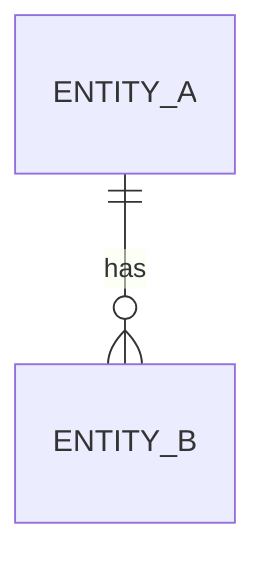

# Entities, keys and relationships

> One block per business entity. Sources cited for every statement. Diagram first, details after.

## TODO: <Entity> (business name)
- **Definition**: what one instance is, in business words (and what it is NOT).
- **Primary table**: `<schema>.<table>` — grain.
- **Ids**: business key `<col>` (format), surrogate key `<col>`, provider / legacy ids `<col>` (since when).
- **Relationships**: 1-n to `<Entity>` via `<table>.<col>` = `<table>.<col>`; watch out for double counting when …
- **Common filters**: see [rules.md](rules.md#…).
- **Source**: `<path to yml / doc>`
