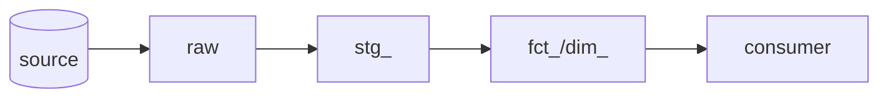

# Design

## Context

## Lineage

## Model
<!-- Grain sentence; keys (natural + surrogate); facts / dimensions; SCD type per attribute; time zone; currency. -->

## Load strategy
<!-- full / incremental (unique_key, lookback) / CDC / streaming; idempotency; partitioning & clustering. -->

## Orchestration
<!-- schedule, upstream dependencies, retries, SLA alert, backfill command, reprocessing plan. -->

## Quality plan
| Scenario | Test (type / name) | Layer |
|---|---|---|
| | | |

## Governance & cost
<!-- PII columns + masking, retention, access roles; cost per run / per day and guardrails. -->

## Decisions

## Risks / Trade-offs

## Rules applied
