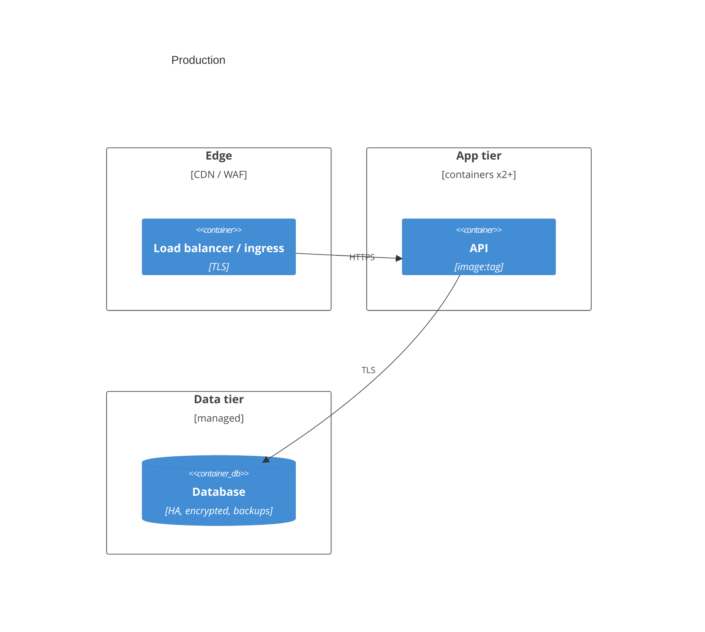

# Platform & operations
<!-- Owned by DevOps (kit-devops). Living document: matches what is actually deployed. Decisions → docs/adr/. -->

## 1. Environments
| Env | Purpose | Hosting | Data | Access | Deployed by / when |
|---|---|---|---|---|---|
| local | development | docker compose | synthetic | developer | `kit-run up` |
| staging | QA / UAT | | anonymised | team | merge to develop |
| prod | users | | real | restricted | release tag + approval |

## 2. Hosting model & topology
<!-- VPS + compose / PaaS / Kubernetes (ADR). Network zones, ingress/TLS, egress, DNS, managed services. -->

## 3. Build, release & CI/CD
| Stage | What | Gate |
|---|---|---|
| guard | secrets, branch, commit messages | required |
| quality | format, lint, types, arch, tests, specs | required |
| security | SAST, dependencies, IaC misconfig, SBOM | required |
| build | image build, scan, push (tag = version) | main/develop |
| deploy staging | automatic | smoke tests |
| deploy prod | manual approval | rollback plan ready |

## 4. Deployment strategy & rollback
<!-- rolling / blue-green / canary; migration order expand → migrate → contract; feature flags; exact rollback steps. -->

## 5. Secrets & configuration
| Secret / config | Store | Rotation | Consumers |
|---|---|---|---|

## 6. Observability & SLOs
| Capability | SLI | SLO | Alert (burn rate) | Runbook |
|---|---|---|---|---|
| | p95 latency, error rate | 99.9% / 28d | fast 2% in 1h, slow 5% in 6h | docs/platform/runbooks/… |

## 7. Backup & disaster recovery
| Data | Backup method | Frequency | Retention | Encrypted | Last restore test | RTO / RPO |
|---|---|---|---|---|---|---|

## 8. Sizing & cost
See `sizing.md`.

## 9. Open items for a human to apply
<!-- terraform apply, secrets to create, DNS, environment protection, approvals. -->
