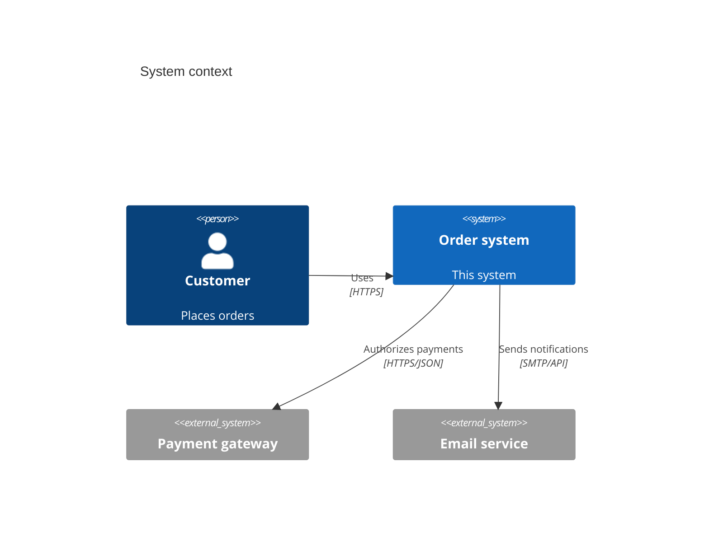
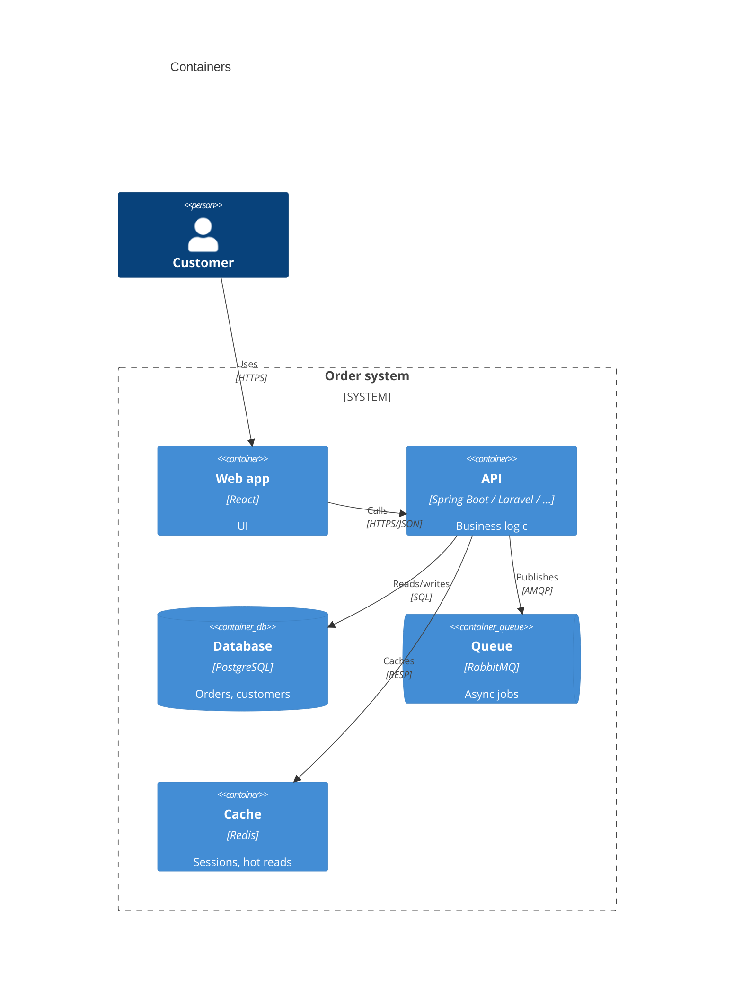

# Solution architecture — <system>
<!-- arc42-lite. Owned by the solution architect (kit-sa) as the MAP of the solution: short sections, links to the specialist docs
     (docs/platform, docs/security, docs/data, docs/api). Decisions → docs/adr/. -->

## 0. Architecture interview (kit-sa §1b)
<!-- 4–6 closed questions on drivers (team, deploy/scale independence, load, reliability, domain complexity, ops & budget,
     integrations, clients). Unanswered → "ASSUMPTION: <recommended>" — a human turns it into "CONFIRMED: <answer> (who, date)". -->
| # | Driver | Question (options) | Recommended | Answer | Who / date |
|---|---|---|---|---|---|

## 1. Goals & constraints
| Goal (from BA) | Constraint (tech, legal, budget, team, deadline) |
|---|---|

## 2. Quality scenarios (ranked)
| # | Attribute | Scenario (stimulus → response) | Measure |
|---|---|---|---|
| Q1 | Performance | 500 concurrent users place orders at peak | p95 < 800 ms, error rate < 0.1% |
| Q2 | Availability | one app node dies | no user-visible outage; RTO 15 min, RPO 5 min |

## 3. Context (C4 level 1)

## 4. Solution strategy
<!-- 5–8 bullets: architecture style, key technologies, how top scenarios are met. Link options/*.md and ADRs. -->

## 5. Containers (C4 level 2)

| Container | Responsibility | Tech | Owns data | Scales by |
|---|---|---|---|---|

## 6. Modules & boundaries
<!-- Source of truth: .agent/rules/project/modules.md (enforced by the stack's arch test, drift checked by kit-trace).
     Folder layout for BE + FE: docs/architecture/project-structure.md. Keep only the dependency diagram here. -->

## 7. Runtime scenarios
<!-- sequence diagrams for the 2–3 most important / risky flows, incl. failure paths -->

## 7b. Patterns & core logic hotspots
<!-- kit-sa §5b + PATTERNS.md. Every pattern names the requirement it serves. One row per hard rule from the BA hand-off. -->
| Hotspot (BR / FR) | Pattern | Algorithm / data structure | Complexity & limits | Consistency / concurrency | Test approach |
|---|---|---|---|---|---|

## 8. Platform (owned by DevOps → `docs/platform/PLATFORM.md`)
<!-- 3 lines: hosting model, environments, deploy strategy, SLO headline. Details live in docs/platform/. -->

## 9. Security (owned by AppSec → `docs/security/`) · Data (owned by Data → `docs/data/`)
<!-- 3 lines each: ASVS level, auth approach, top risks / analytics architecture, key pipelines. -->

## 9b. Cross-cutting decisions
AuthN/Z approach · multitenancy · error model (RFC 9457) · configuration · i18n · ID strategy — each links its ADR.

## 9c. Cost envelope
<!-- Order of magnitude per month for the chosen style; detailed sizing by DevOps in docs/platform/sizing.md. -->

## 10. Decisions
| ADR | Decision | Status |
|---|---|---|

## 11. Risks & technical debt
| Risk | Probability | Impact | Mitigation | Owner |
|---|---|---|---|---|
