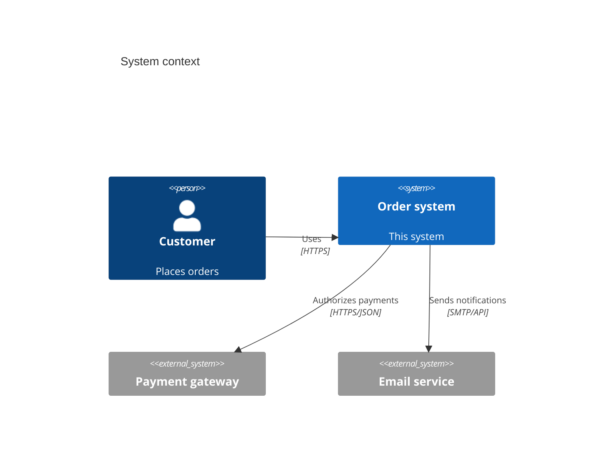
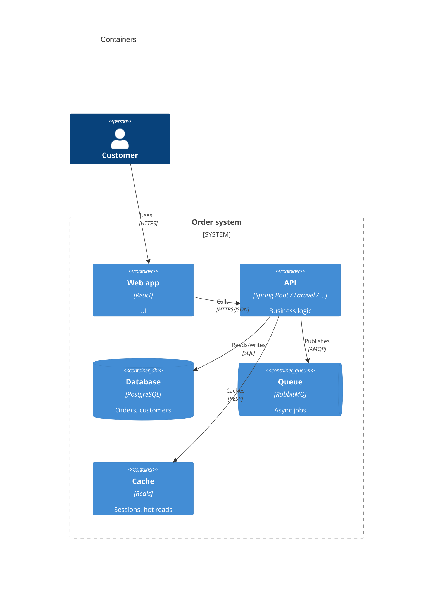
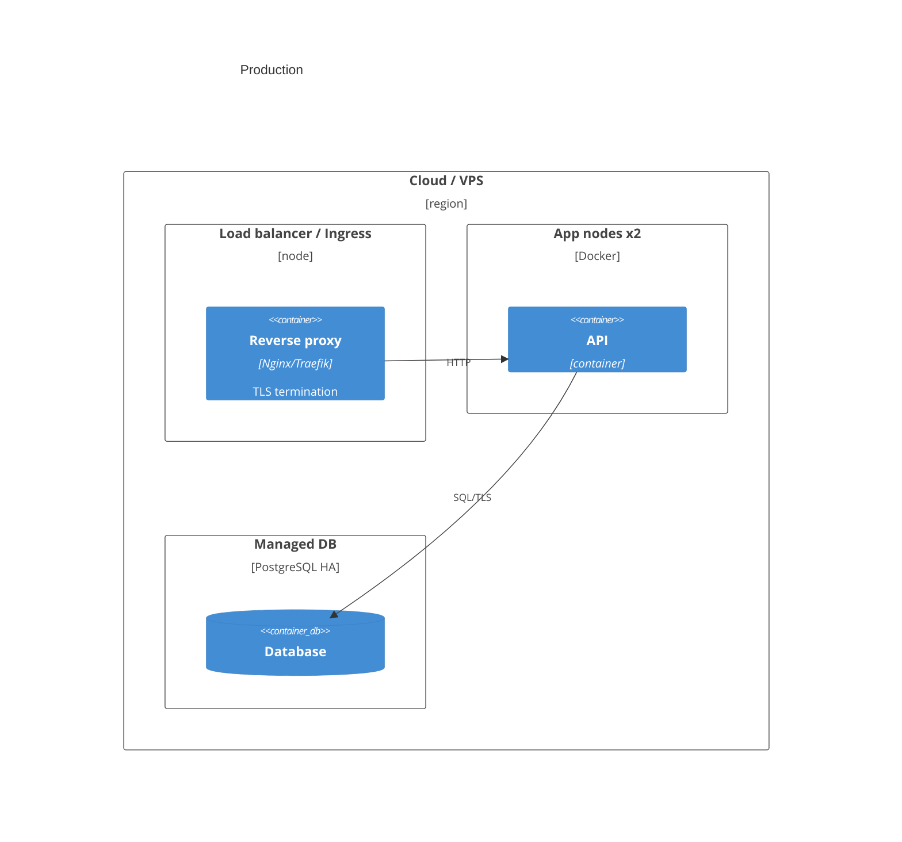

# Solution architecture — <system>
<!-- arc42-lite. Filled by kit-sa. Keep each section short; link details. Decisions → docs/adr/. -->

## 1. Goals & constraints
| Goal (from BA) | Constraint (tech, legal, budget, team, deadline) |
|---|---|

## 2. Quality scenarios (ranked)
| # | Attribute | Scenario (stimulus → response) | Measure |
|---|---|---|---|
| Q1 | Performance | 500 concurrent users place orders at peak | p95 < 800 ms, error rate < 0.1% |
| Q2 | Availability | one app node dies | no user-visible outage; RTO 15 min, RPO 5 min |

## 3. Context (C4 level 1)

## 4. Solution strategy
<!-- 5–8 bullets: architecture style, key technologies, how top scenarios are met. Link options/*.md and ADRs. -->

## 5. Containers (C4 level 2)

| Container | Responsibility | Tech | Owns data | Scales by |
|---|---|---|---|---|

## 6. Modules & boundaries
| Module | Responsibility | May depend on | Enforced by |
|---|---|---|---|

## 7. Runtime scenarios
<!-- sequence diagrams for the 2–3 most important / risky flows, incl. failure paths -->

## 8. Deployment

| Env | Purpose | Hosting | Data | Deploy trigger |
|---|---|---|---|---|
| local | dev | docker compose | synthetic | — |
| staging | QA/UAT | | anonymised | merge to develop |
| prod | users | | real | release tag + approval |

## 9. Cross-cutting concepts
Security (authN/Z, secrets, zones) · Observability (logs, metrics, traces, SLOs, alerts) · Data (backup, retention, migration) ·
Resilience (timeouts, retries, circuit breakers, idempotency) · Configuration · i18n.

## 10. Decisions
| ADR | Decision | Status |
|---|---|---|

## 11. Risks & technical debt
| Risk | Probability | Impact | Mitigation | Owner |
|---|---|---|---|---|
