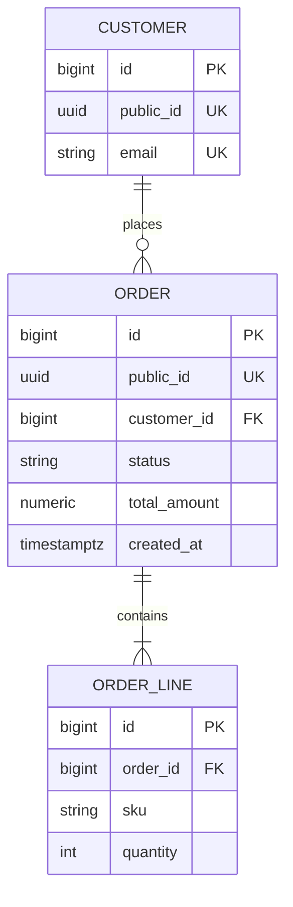

# Application data model
<!-- Owned by kit-datamodel / solution architect. Living: matches the migrations. ID strategy & multitenancy → ADRs. -->

## Decisions
| Topic | Decision | ADR |
|---|---|---|
| ID strategy | | |
| Multitenancy | | |
| Soft delete / audit | | |

## Ownership
| Table | Module (owner) | Aggregate root | Read by (via API/events) |
|---|---|---|---|

## ERD — <module>

## Data dictionary
| Table.column | Type | Null | Constraint / index | Meaning | PII |
|---|---|---|---|---|---|
