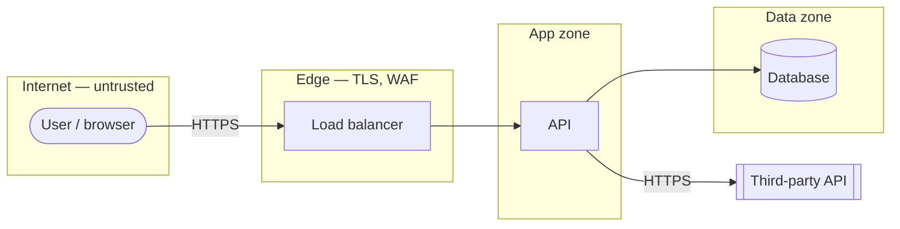

# Threat model
<!-- kit-appsec. Living document: update when a trust boundary, asset, integration or personal-data flow changes. -->

## Scope & assets
| Asset | Sensitivity | Where |
|---|---|---|

## Data-flow diagram (trust boundaries)

## STRIDE
| ID | Element / flow | Threat (S/T/R/I/D/E) | Likelihood | Impact | Risk | Control | Status / owner |
|---|---|---|---|---|---|---|---|
| T-01 | api ← user | S: credential stuffing | M | H | High | rate limit + lockout + MFA for admins | planned |

## Abuse cases
-

## Accepted risks (named human + date required)
| ID | Risk | Why accepted | Who | Date | Review by |
|---|---|---|---|---|---|
